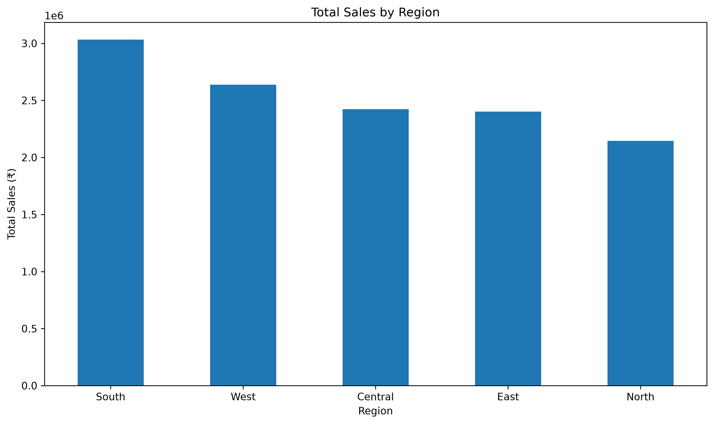
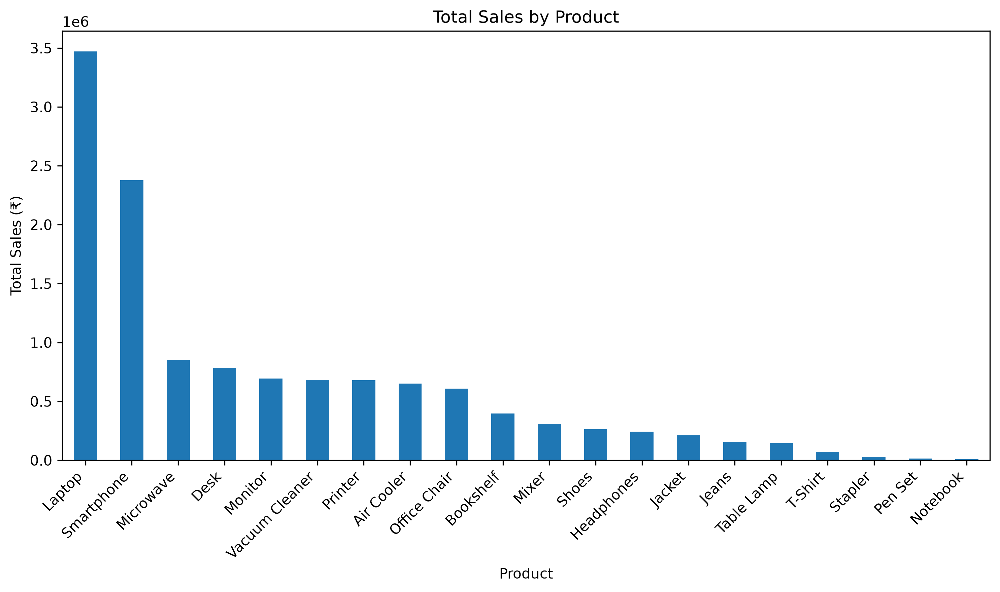
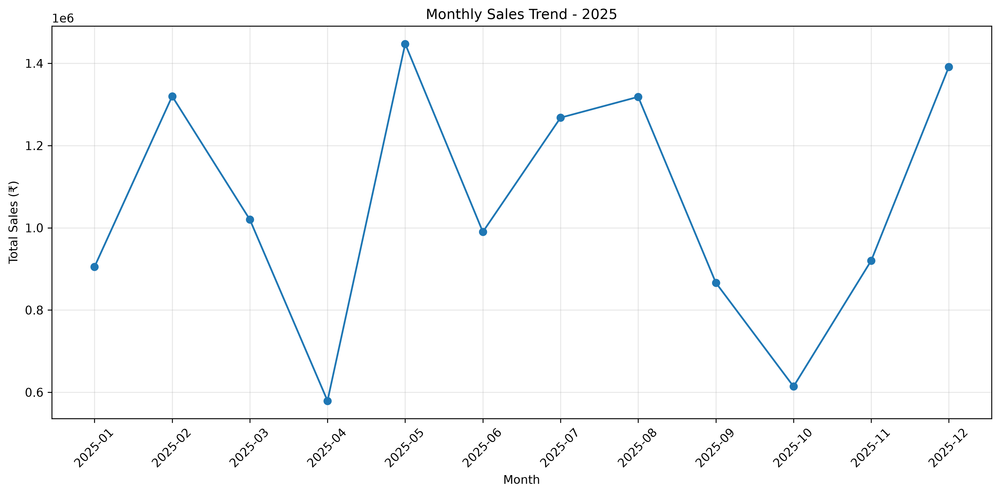
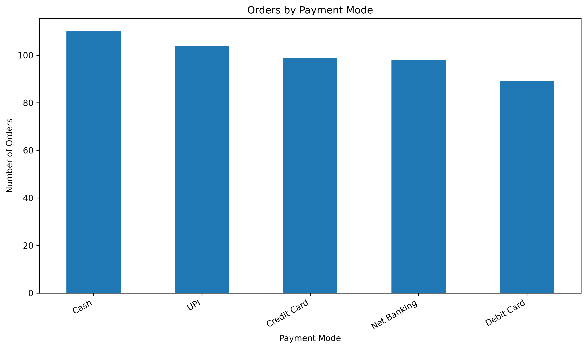

# Sales Data Analysis Project

## Overview
This project analyses sales data using Python, Pandas, and MySQL to identify sales trends, customer purchasing patterns, product performance, and payment preferences.

## Project Objectives
- Analyse overall sales performance.
- Compare sales across regions.
- Identify top-performing products and customers.
- Examine monthly sales trends.
- Analyse payment methods.
- Investigate the relationship between discounts and sales.

## Tools and Technologies
- Python
- Pandas
- Jupyter Notebook
- MySQL
- SQL

## Project Structure

Sales_Data_Analysis/
- Data/ — Dataset used for analysis
- Notebooks/ — Python notebook for dataset creation and analysis
- Dashboard/ — Reserved for future Power BI dashboard
- sales_analysis.sql — SQL analysis queries
- project_insights.txt — Summary of findings

## Key Findings
- Total sales revenue: ₹12,640,198
- Total records analysed: 500
- Total quantity sold: 1,532
- Average sales per order: ₹25,280.40
- Top-performing region by revenue: South
- Highest-revenue product: Laptop
- Highest-sales month: May 2025
- Most-used payment method: Cash, with 110 orders

## Visualizations

### 1. Total Sales by Region

### 2. Total Sales by Product

### 3. Monthly Sales Trend

### 4. Orders by Payment Mode

## Current Status
Python and SQL analyses have been completed.
The Power BI dashboard is planned for a future stage.

## Future Improvements
- Build an interactive Power BI dashboard.
- Improve visualisation of sales trends.
- Add further business insights.